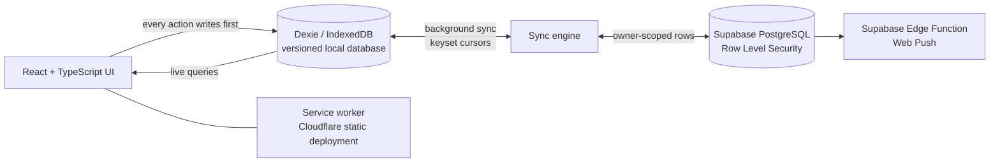

# GymTrack Core: local-first data layer and sync engine

[](https://github.com/MadniAbdulWahab/gymtrack-core/actions/workflows/test.yml)

GymTrack is a mobile-first, installable workout tracker I built and use for my own training. Logging
works instantly and offline; an account adds backup and sync across devices.

**Live app:** [gym-tracker.madniabdulwahab.workers.dev](https://gym-tracker.madniabdulwahab.workers.dev)

This repository contains the app's **core data layer**, taken unchanged from the full application:
the versioned IndexedDB database, the Supabase synchronisation engine, the account-ownership guard,
the PostgreSQL migrations with row-level security, and their tests. The UI code stays in a private
repository.

<p>
  
  
  
</p>

## Why I built it

I train regularly and logged my workouts in Strong, but its progress analytics sit behind
a paid subscription. I wanted to see my own progress without paying for access to my own
data, so I built GymTrack, imported my Strong history through its CSV export, and now use
it for my own training.

## Design decisions and trade-offs

- **Keyset cursors instead of offset paging.** If rows change while a sync is paging,
  offsets shift and rows get skipped or sent twice. Paging by `(updatedAt, id)` keeps a
  stable order, and the `id` breaks ties when two rows share a timestamp.
- **Last-write-wins per row.** Simple and predictable for one person on a few devices.
  The trade-off: if the same set is edited on two offline phones, the later edit wins.
- **Ownership guard.** Without it, signing into a different account on the same phone
  would upload one person's history into another person's account. Sync pauses and asks
  instead of guessing.
- **Local writes first.** Logging a set never waits for the network; every action is
  saved on the device first and synced in the background.

## What it does

- Strength and cardio logging, reusable routines, body-weight tracking
- Progress analytics: sessions, volume, sets, consistency and personal records
- Strong CSV import, plus JSON and CSV backup, restore and export
- Rest-timer alerts through Web Push on installed devices

## Architecture



**Local-first.** Every user action writes to a versioned Dexie/IndexedDB database immediately, and
the UI reads live local state. The network never blocks logging a set or finishing a workout.

**Synchronisation.** A background sync engine pages through each table with `(updatedAt, id)`
keyset cursors, pushes and pulls in batches, applies last-write-wins per row, and resumes on
reconnect or when the app returns to the foreground.

**Ownership guard.** Before any pull or push, the app checks whether local data belongs to the
signed-in account. If a phone holds unowned history, sync pauses until the user chooses to upload it
or restore the account, so two people's histories are never mixed silently.

**Database.** Supabase/PostgreSQL migrations define owner-scoped Row Level Security for workouts,
routines, sets, cardio, body weight, settings and push subscriptions.

**Persistence-first completion.** Finishing a workout commits the result before navigation; the
completion summary is rebuilt from IndexedDB, so a refresh or a suspended browser cannot lose it.

**Updates without interruptions.** The PWA uses a prompt-based service-worker update, so a new
build activates only when the user taps Update, never in the middle of a workout.

## Code in this repository

| Path | What it does |
|---|---|
| `src/db/db.ts` | Versioned Dexie/IndexedDB schema with upgrade migrations and seeding |
| `src/db/types.ts` | Domain types for workouts, sets, routines, cardio, body weight and settings |
| `src/lib/sync/engine.ts` | Keyset-paginated pull and push, last-write-wins merge, reconnect and foreground triggers |
| `src/lib/sync/mappings.ts` | Mapping between local camelCase rows and remote snake_case columns, per table |
| `src/lib/sync/accountOwnership.ts` | Guard that pauses sync when local data does not belong to the signed-in account |
| `supabase/migrations/` | PostgreSQL schema, owner-scoped Row Level Security policies and later migrations |
| `**/*.test.ts` | 31 Vitest tests using an in-memory IndexedDB (`fake-indexeddb`) |

Run the tests:

```bash
npm ci
npm test          # 31 tests: sync paging, merge rules, ownership guard, schema upgrades, seed data
npm run typecheck # TypeScript in strict mode
```

The full application has 100+ tests across these modules and its UI, analytics, timers and
import/export.

## Stack

React 19 · TypeScript · Vite · Dexie (IndexedDB) · Supabase (Auth, PostgreSQL, RLS, Edge
Functions) · Recharts · Vitest · Cloudflare static assets

## Quality

- 100+ automated Vitest tests covering database migrations, sync and keyset pagination, ownership
  safeguards, analytics, workout logic, timers and import/export compatibility
- Linting with oxlint

## About

Built by [Abdul Wahab Madni](https://github.com/MadniAbdulWahab), research software engineer at the
University of Bonn. Exercise artwork was created for this app; the muscle diagram uses the
MIT-licensed `react-body-highlighter`.
