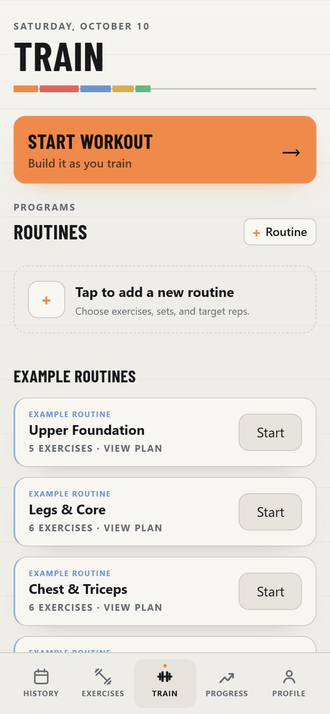
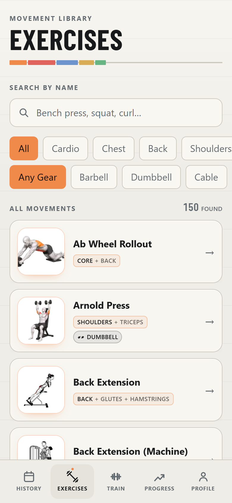
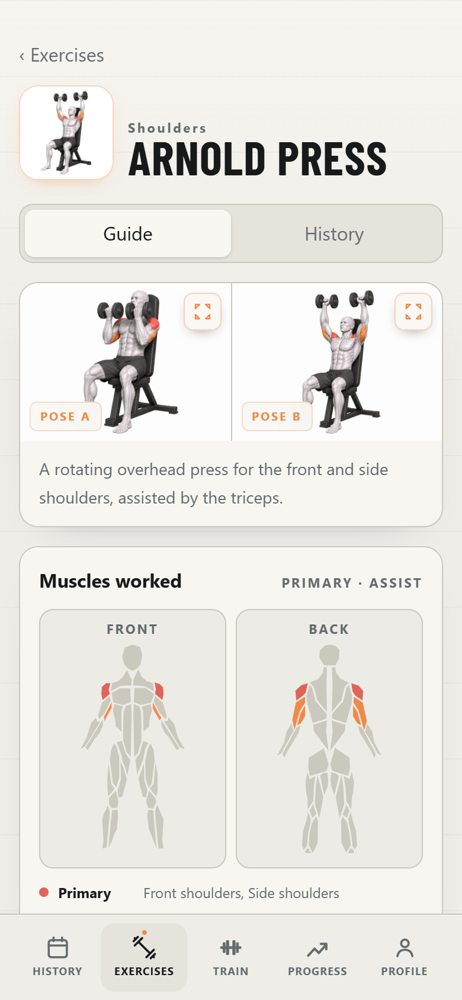
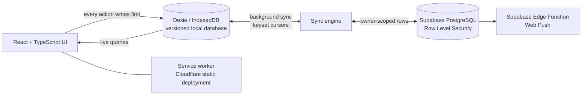

# GymTrack: Workout & Progress Tracking App

A mobile-first, installable workout tracker I built and use for my own training. Logging works
instantly and offline; an account adds backup and sync across devices.

**Live app:** [gym-tracker.madniabdulwahab.workers.dev](https://gym-tracker.madniabdulwahab.workers.dev)

The source repository is private. This page shows what the app does and how it is built.

  
  
  

## What it does

- Strength and cardio logging, reusable routines, body-weight tracking
- Progress analytics: sessions, volume, sets, consistency and personal records
- Strong CSV import, plus JSON and CSV backup, restore and export
- Rest-timer alerts through Web Push on installed devices

## Architecture

**Local-first.** Every user action writes to a versioned Dexie/IndexedDB database immediately, and
the UI reads live local state. The network never blocks logging a set or finishing a workout.

**Synchronisation.** A background sync engine pages through each table with `(updatedAt, id)`
keyset cursors, pushes and pulls in batches, applies last-write-wins per row, and resumes on
reconnect or when the app returns to the foreground.

**Ownership guard.** Before any pull or push, the app checks whether local data belongs to the
signed-in account. If a phone holds unowned history, sync pauses until the user chooses to upload it
or restore the account, so two people's histories are never mixed silently.

**Database.** Supabase/PostgreSQL migrations define owner-scoped Row Level Security for workouts,
routines, sets, cardio, body weight, settings and push subscriptions.

**Persistence-first completion.** Finishing a workout commits the result before navigation; the
completion summary is rebuilt from IndexedDB, so a refresh or a suspended browser cannot lose it.

**Updates without interruptions.** The PWA uses a prompt-based service-worker update, so a new
build activates only when the user taps Update, never in the middle of a workout.

## Stack

React 19 · TypeScript · Vite · Dexie (IndexedDB) · Supabase (Auth, PostgreSQL, RLS, Edge
Functions) · Recharts · Vitest · Cloudflare static assets

## Quality

- 100+ automated Vitest tests covering database migrations, sync and keyset pagination, ownership
  safeguards, analytics, workout logic, timers and import/export compatibility
- Linting with oxlint

## About

Built by [Abdul Wahab Madni](https://github.com/MadniAbdulWahab), research software engineer at the
University of Bonn. Exercise artwork was created for this app; the muscle diagram uses the
MIT-licensed `react-body-highlighter`.
